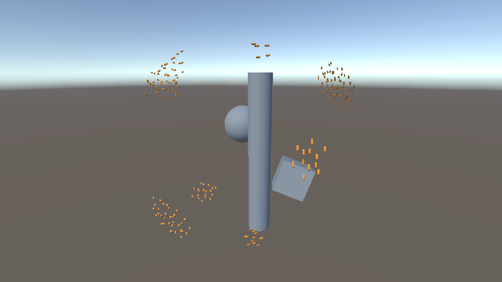

# NeuroBoids: bando emergente (Boids, Reynolds 1987) no Unity 6

200 agentes que se agrupam, fluem e desviam de obstáculos **sem líder e sem coreografia**.
Cada boid só enxerga os vizinhos dentro do seu raio de percepção. O comportamento do bando
surge de três regras locais (separação, alinhamento e coesão), avaliadas a cada passo de física.

## Como abrir a cena principal

1. Abra o **Unity Hub** → **Add** → **Add project from disk** e selecione a pasta `NeuroBoids`.
   O projeto usa o Unity **6000.3.6f1** (Unity 6) com URP.
2. No Unity, abra a janela **Project** e dê dois cliques em **`Assets/Scenes/NeuroBoids.unity`**.
   Essa cena também é a primeira em *File → Build Profiles*.
3. Aperte **Play**. A câmera orbita sozinha ao redor do bando.
4. Para ver o raio de percepção durante o Play, ligue o botão **Gizmos** no topo da *Game view*
   ou acompanhe pela *Scene view*. O `Boid_000` desenha:
   - esfera amarela: raio de percepção;
   - esfera vermelha: raio de separação;
   - linhas verdes: vizinhos atuais;
   - linha ciano: velocidade;
   - linhas magenta: o SphereCast e a direção refletida quando há obstáculo à frente.

   Para mudar qual boid desenha os Gizmos, altere `Gizmo Boid Index` no `FlockManager`.
   Selecionar qualquer boid também mostra os Gizmos dele.

Os pesos e raios ficam todos no componente **FlockManager** e podem ser alterados no
Inspector **durante o Play**. O efeito é imediato.

Se precisar recriar a cena, as camadas, os materiais e o prefab do zero, use o menu
**NeuroBoids → Rebuild Scene** (script `Assets/NeuroBoids/Editor/NeuroBoidsSetup.cs`).

## Estrutura

| Arquivo | Função |
|---|---|
| `Assets/Scenes/NeuroBoids.unity` | Cena principal: FlockManager, 3 obstáculos, predador (desativado), câmera e luz |
| `Assets/NeuroBoids/Prefabs/Boid.prefab` | Prefab com `Rigidbody`, `SphereCollider` e o script `Boid`, na camada **Boid** |
| `Assets/NeuroBoids/Scripts/Boid.cs` | As regras do bando (`ComputeForce`), integração, segurança numérica e Gizmos |
| `Assets/NeuroBoids/Scripts/FlockManager.cs` | Instancia os boids, guarda os parâmetros, avança a simulação e calcula estatísticas |
| `Assets/NeuroBoids/Scripts/Predator.cs` | Esfera vermelha que persegue o bando |
| `Assets/NeuroBoids/Scripts/CameraOrbit.cs` | Órbita automática da câmera |
| `Assets/NeuroBoids/Editor/NeuroBoidsSetup.cs` | Gera camadas, materiais, prefab e cena (menu *NeuroBoids*) |
| `Screenshots/` | Capturas dos testes descritos abaixo |

Camadas: **Boid** (6), **Obstacle** (7) e **Predator** (8). As colisões físicas entre
boids ficam desligadas, porque quem os mantém afastados é a regra de separação. Já entre boids
e obstáculos a colisão continua ligada, como uma segunda barreira.

## Como funciona

A cada `FixedUpdate`, o `FlockManager` executa duas fases. Primeiro, **todos** os boids
calculam sua força a partir do mesmo retrato do bando. Depois, **todos** integram a força.
Assim, a ordem de atualização não favorece nenhum boid.

`Boid.ComputeForce()` soma estes termos, cada um multiplicado pelo seu peso:

| Regra | Cálculo |
|---|---|
| **Separação** | Σ sobre vizinhos com d < `separationRadius` de `direção_para_longe / d²` × `maxForce`. A intensidade é ∝ **1/d²**: a 1 m o empurrão vale `maxForce`, a 0,5 m vale 4×. Usa d ≥ 0,1 m para evitar divisão por zero. |
| **Alinhamento** | Steering de Reynolds para a direção média das velocidades dos vizinhos: `normalize(v̄) · maxSpeed − v`. |
| **Coesão** | Aceleração em direção ao centro de massa local, proporcional à distância: `(centro − pos) · maxForce / perceptionRadius`. |
| **Limites do mundo** | **Zero** dentro de `boundsRadius`. Fora dele, uma mola puxa de volta ao centro: `(dist − boundsRadius) · boundsStrength`. |
| **Obstáculos** | `Physics.SphereCast` na direção do voo. Se acerta algo, usa `Vector3.Reflect(direção, normal)` (mais um pouco da normal) como direção desejada, com urgência que cresce quando o obstáculo está perto. |
| **Fuga** | Se o predador está a menos de `fleeRadius`, aplica steering para longe dele com peso alto. Em pânico, o limite de velocidade sobe para `maxSpeed × 1,5`. |

**Percepção sem lixo para o GC:** usa `Physics.OverlapSphereNonAlloc(pos, raio, buffer, boidMask)`
com **um único** `Collider[]` alocado no `Awake` do `FlockManager` e compartilhado por todos os
boids. A posição e a velocidade do vizinho vêm de `collider.attachedRigidbody`, sem
`GetComponent`. O SphereCast usa `RaycastHit`, que é struct. O código não usa
`OverlapSphere`, `FindObjectsOfType`, LINQ nem `foreach` sobre listas no loop.
Uma medição com `GC.GetAllocatedBytesForCurrentThread()` em 100 passos × 200 boids, com
predador ativo, deu **0 bytes alocados**.

**Segurança numérica (`Boid.ApplyStep`):**
- a força final é limitada por `maxForce` (`Vector3.ClampMagnitude`);
- a velocidade é limitada por `maxSpeed`, com `minSpeed` para o boid não parar;
- `Quaternion.LookRotation` só é chamado quando |v| > 0,01;
- forças, velocidades, posições e rotações passam por `float.IsFinite`. Se algo virar NaN ou
  infinito, o valor é substituído e o boid é reposicionado em vez de sumir. Em todos os testes,
  0 boids ficaram com NaN e 0 boids entraram em obstáculos.

## Parâmetros finais

Valores do `FlockManager` na cena `NeuroBoids.unity`:

| Parâmetro | Valor | Observação |
|---|---|---|
| Número de boids (`boidCount`) | **200** | |
| Peso da **separação** | **1,5** | |
| Peso do **alinhamento** | **1,5** | |
| Peso da **coesão** | **0,8** | |
| Peso dos limites | 1,0 | `boundsStrength` = 6 por metro fora do raio |
| Peso do desvio de obstáculos | 6,0 | SphereCast: raio 0,5 m, alcance 3 m + 0,35 × velocidade |
| Peso da fuga | 12,0 | `fleeRadius` = 7 m, pânico = 1,5 × `maxSpeed` |
| **Raio de percepção** | **3,0 m** | `maxNeighbors` = 64 (tamanho do buffer) |
| **Raio de separação** | **2,0 m** | |
| Raio do mundo (`boundsRadius`) | 22 m | força de retorno zero dentro dele |
| **maxSpeed** | **6 m/s** | `minSpeed` = 2 m/s |
| **maxForce** | **8 m/s²** | massa 1, então força = aceleração |
| Predador | 8 m/s | aceleração 10 m/s², troca de alvo a cada 2,5 s |

## Testes

Cada teste partiu da cena com os parâmetros finais. Mudei só o parâmetro indicado, esperei
cerca de 30 s de simulação e li as estatísticas do bando. A medição pode ser repetida com o
botão direito no `FlockManager` → **Log Flock Stats**, ou com `Log Stats Every` > 0.

- **grupos**: quantidade de componentes conectados quando boids a menos de 3 m contam como do mesmo grupo.
- **polarização**: |média das direções| dentro de cada grupo. 1 significa todos voando juntos; ~0 significa caos.
- **NN**: distância média até o vizinho mais próximo.

| Teste | Grupos (maior) | Polarização | NN | Vizinhos/boid | Velocidade |
|---|---|---|---|---|---|
| Parâmetros finais | 9–10 (62) | 0,93–1,00 | 1,9 m | 8 | 5,8 m/s |
| Separação = 0 | 13–14 (34) | 1,00 | **0,1 m** (mín. 0) | 13–19 | 5,9 m/s |
| Alinhamento = 0 | **104–123 (≤13)** | 0,80–0,84 | 3,0 m | 1,2 | **3,8 m/s** |
| Percepção 0,5 | **136–153 (≤11)** | 0,87 | 3,4 m | **0** | 4,5 m/s |
| Percepção 5,0 | **4 (72)** | 1,00 | 1,8 m | **36** | 5,8 m/s |
| Predador ativo | 20–38 (28–62) | 0,91–0,99 | 1,7–2,0 m | 7 | 5,5–5,7 m/s, até 40 boids fugindo |

### Peso da separação = 0: o que sobra do bando?

Sobra só coesão com alinhamento. Os boids colapsam em pontos: a distância ao vizinho mais
próximo cai de 1,9 m para cerca de 0,1 m (o mínimo chega a 0), e cada grupo vira um "boid
único" com dezenas de agentes sobrepostos. Esses pontos andam perfeitamente alinhados
(polarização 1,00), mas o bando perde volume e forma. Na tela parecem restar uns 13 boids
([sep0.png](Screenshots/sep0.png)).

### Peso do alinhamento = 0: o que acontece agora?

O bando deixa de ser bando e vira um enxame de mosquitos. Sem ninguém copiando a direção dos
vizinhos, cada boid voa para um lado: a separação afasta, a coesão puxa, mas nada sincroniza
o movimento. A velocidade média cai para perto de `minSpeed` (3,8 m/s), os grupos se
fragmentam em mais de 100 pedaços de até 13 boids, e a nuvem fica difusa e sem direção
coletiva ([ali0.png](Screenshots/ali0.png)).

### Raio de percepção 0,5 versus 5,0: como o formato do bando muda?

- **0,5 m**: menor que o espaçamento natural entre boids, então praticamente ninguém tem
  vizinhos (média 0). As três regras param de atuar, e cada boid voa sozinho em linha reta até
  bater no limite do mundo. O resultado é uma "poeira" espalhada sem formação, com mais de 136
  "grupos" ([perc05.png](Screenshots/perc05.png)).
- **5,0 m**: cada boid enxerga uns 36 vizinhos, e a informação se espalha rápido. O bando
  converge para **poucos grupos grandes e compactos** (4 grupos, o maior com 72), em forma de
  bolas ou discos densos, todos perfeitamente alinhados e que raramente se dividem
  ([perc5.png](Screenshots/perc5.png)).

Em resumo, um raio pequeno fragmenta o bando e um raio grande o deixa coeso e "rígido".
O valor de 3 m fica no meio-termo: grupos que fluem, se dividem e se reencontram.

### Predador: qual é o efeito no grupo?

Para o teste, ative o GameObject **Predator** na hierarquia. A esfera vermelha mergulha no
miolo do maior grupo a cada 2,5 s, e a regra de fuga (peso 12, maior que todas as outras)
domina o `ComputeForce` de quem está a menos de 7 m dela.

Os efeitos observados foram:
- abre-se um **vazio esférico** ao redor do predador, do tamanho do `fleeRadius`, com os boids
  contornando a esfera como um anel ([gizmo_scene.png](Screenshots/gizmo_scene.png));
- o grupo **se parte em dois ou mais pedaços**, que fogem em direções diferentes (o "efeito
  fonte"): o número de grupos sobe de cerca de 10 para 20–38, e o maior cai de 60–100 para
  30–60 ([predator.png](Screenshots/predator.png));
- os boids em fuga aceleram até 9 m/s, mais que os 8 m/s do predador. Por isso ele quase nunca
  alcança ninguém;
- quando o predador troca de alvo, a coesão e o alinhamento **reúnem os pedaços** em poucos
  segundos.

A onda de pânico se propaga por vizinhança: só uns 10 a 40 boids "veem" o predador, mas o
alinhamento transmite a manobra para o resto do grupo.

## Feito por
Alexandre Inácio Tavares
